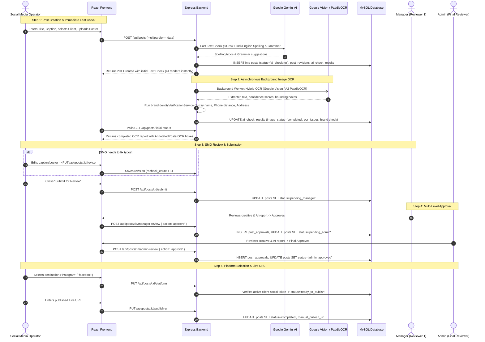

# Project Context Report — Social Approval Workflow Platform
*Generated from Graphify Knowledge Base & Verified Source Code Analysis*

---

## 1. Executive Summary & Project Purpose (क्या हो रहा है?)

**Social Approval Workflow Platform** (working title: *MultiPost Hub / Central Post Hub*) is an **agency-grade multi-client social media post approval and automated quality assurance platform**.

### Core Business Purpose
In a digital marketing agency handling multiple healthcare, corporate, and retail clients:
1. **Multi-Tenant Client Isolation**: Different clients (e.g. *Bal-Gopal Children's Neuro Clinic*, *Zenith Organics*) have separate brand guidelines, phone numbers, addresses, whitelists, banned keywords, and connected social media accounts (Instagram, Facebook).
2. **AI-Assisted Pre-Flight Quality Assurance**:
   - **Bilingual Text Check (< 1–2 sec)**: Validates Hindi (Devanagari) and English captions and titles using Google Gemini (`gemini-flash-lite-latest`) for real spelling mistakes and grammatical syntax flaws, backed by local dictionaries (nspell, Hunspell).
   - **Hybrid OCR & Image Text Verification (10–25 sec in background)**: Uses a hybrid OCR pipeline:
     - **Hindi / Mixed Posters**: Google Vision OCR (Primary) $\rightarrow$ A2 Hosting PaddleOCR (Fallback).
     - **English Posters**: A2 Hosting PaddleOCR (Primary) $\rightarrow$ Google Vision OCR (Fallback if confidence < 80% or error).
   - **Poster Text Visualization (`AnnotatedPosterOCR`)**: Overlays numbered bounding boxes on the actual poster with a 3-way triage:
     - 🔴 **RED**: Confirmed human error / designer typo (blocks approval).
     - 🟡 **YELLOW**: Low OCR confidence (< 80%) or stylized artistic font artifacts (flagged as doubt, **never blocks approval**).
     - 🟢 **GREEN**: Verified text passing all checks.
   - **Brand Identity & Compliance Engine**: Verifies brand name spelling via sliding n-gram fuzzy matching (`fuzzball`), extracts and normalizes contact numbers against registered client numbers using Levenshtein distance, checks addresses, and flags banned or missing mandatory phrases.
3. **Multi-Tier Strict Human Approval Workflow**:
   - **SMO (Social Media Operator)**: Creates post, uploads creative, reviews AI feedback, iterates up to 3 revisions, and submits.
   - **Manager / Team Lead**: Reviews the creative, caption, and AI findings. Can Approve, Request Changes, or Reject.
   - **Admin (Final Reviewer)**: Final approval gatekeeper. Self-approval is strictly blocked across roles.
4. **Publishing & Reconciliation**: Once approved by Admin, the post enters `admin_approved` $\rightarrow$ SMO/Admin selects target connected social account $\rightarrow$ status becomes `ready_to_publish` $\rightarrow$ post is published and the live post URL is recorded, completing the lifecycle (`completed`).

---

## 2. Technology Stack & Environment

| Layer | Technology | Details |
|---|---|---|
| **Frontend** | React 19, Vite 8, Tailwind CSS v4 | React Router DOM v7, Axios, Lucide React, Custom Toast Context |
| **Backend API** | Node.js (CommonJS), Express 5 | Multer (upload), Morgan, CORS, Bcryptjs, JsonWebToken |
| **Database** | MySQL (InnoDB, `utf8mb4_unicode_ci`) | Connection pooling (`mysql2/promise`), 9 relational tables |
| **AI / NLP** | Google Gemini (`gemini-flash-lite-latest`) | Copy editing for Hindi and English spelling & grammar syntax |
| **Primary OCR** | Google Vision API + PaddleOCR | Bilingual OCR with font ligature protection and bounding boxes |
| **Secondary OCR / Remote** | Python 3.11 WSGI (Phusion Passenger) | Configured for A2 shared hosting (`passenger_wsgi.py`, `app.py`) |
| **NLP & Dictionaries** | `nspell`, `hunspell-asm`, `fuzzball` | `hi_IN.dic` (207,695 Hindi root words), `dictionary-en` |
| **Security** | AES-256-GCM authenticated encryption | Secure storage for client social media access tokens with IV & AuthTag |

---

## 3. Architecture Map (कहाँ क्या है?)

```
Social Approval Workflow platform/
├── backend/                               # Node.js Express REST API server
│   ├── a2-ocr-server/                     # Standalone Python WSGI PaddleOCR server for A2 Hosting
│   │   ├── passenger_wsgi.py              # Passenger WSGI entry point
│   │   ├── app.py                         # WSGI routing, API key auth, health & /check-post
│   │   ├── process_post.py                # PaddleOCR execution, CV2 preprocessing, bounding boxes
│   │   ├── cv2_preprocess.py              # Contrast, CLAHE, LAB, threshold polarity variants
│   │   └── dictionaries/hi_IN/            # Hindi Hunspell affix & dictionary files
│   ├── config/
│   │   └── db.js                          # MySQL connection pool & testConnection helper
│   ├── controllers/
│   │   ├── authController.js              # Register, login, getMe, JWT token generation
│   │   ├── clientController.js            # Client CRUD, brand guidelines, social account OAuth & AES encryption
│   │   └── postController.js              # Post lifecycle, revisions, AI check orchestration, approvals
│   ├── dictionaries/                      # Local Hunspell dictionary assets
│   ├── middleware/
│   │   ├── authMiddleware.js              # Bearer token verification
│   │   ├── roleMiddleware.js              # Role-based access control ('admin', 'manager', 'smo')
│   │   └── uploadMiddleware.js            # Multer disk storage for poster images (max 10MB)
│   ├── models/
│   │   └── schema.sql                     # Full MySQL DDL schema (9 tables)
│   ├── routes/
│   │   ├── authRoutes.js                  # /api/auth endpoints
│   │   ├── clientRoutes.js                # /api/clients & social connection endpoints
│   │   └── postRoutes.js                  # /api/posts lifecycle endpoints
│   ├── scripts/                           # Database migration and diagnostic scripts
│   ├── services/                          # Core business logic & AI pipelines
│   │   ├── aiService.js                   # Master AI orchestrator (merges text & image checks)
│   │   ├── brandIdentityVerificationService.js # Fuzzy brand name, Levenshtein phone & address verification
│   │   ├── brandRulesService.js           # Banned words, mandatory phrases, whitelist fuzzy matching
│   │   ├── garbageFilterService.js        # Filters OCR noise, stray characters & known acronyms
│   │   ├── googleVisionService.js         # Google Cloud Vision OCR client
│   │   ├── grammarService.js              # Gemini-based Hindi/English spelling & grammar copy editor
│   │   ├── hindiDictionaryService.js      # Hunspell Hindi dictionary engine
│   │   ├── spellCheckService.js           # Dual-dictionary spell checking fallback
│   │   └── textCorrectionService.js       # Rule-based OCR ligature / character misread correction
│   ├── utils/
│   │   └── encryption.js                  # AES-256-GCM encryption/decryption for social tokens
│   └── server.js                          # Express application entry point & startup recovery hook
├── client/                                # React 19 Frontend (Vite)
│   ├── src/
│   │   ├── assets/                        # Static icons, Vite/React SVGs
│   │   ├── components/
│   │   │   ├── AnnotatedPosterOCR.jsx     # Interactive poster overlay with numbered bounding boxes (Red/Yellow/Green)
│   │   │   ├── Button.jsx                 # Reusable UI button with loading and variant styles
│   │   │   ├── ImageCheckSkeleton.jsx     # Shimmer skeleton for asynchronous OCR processing
│   │   │   ├── ImageUpload.jsx            # Drag-and-drop image uploader with preview
│   │   │   ├── Navbar.jsx                 # Navigation bar with user identity & logout
│   │   │   ├── PostCard.jsx               # Post summary card with status badges
│   │   │   └── ProtectedRoute.jsx         # Role-based frontend route protection
│   │   ├── context/
│   │   │   ├── AuthContext.jsx            # User state, login, logout, token persistence
│   │   │   └── ToastContext.jsx           # Global toast notifications
│   │   ├── pages/
│   │   │   ├── AdminDashboard.jsx         # Client management, brand rules, tokens, final approvals
│   │   │   ├── Login.jsx                  # Split-view authentication page
│   │   │   ├── ManagerDashboard.jsx       # Mid-tier review dashboard
│   │   │   └── SMODashboard.jsx           # Post creator dashboard with AI feedback & revision loop
│   │   ├── services/
│   │   │   ├── api.js                     # Axios instance with auth interceptor
│   │   │   ├── authService.js             # Auth API endpoints
│   │   │   ├── clientService.js           # Client & guidelines API calls
│   │   │   └── postService.js             # Post CRUD, status polling, reviews & approvals
│   │   ├── utils/                         # Status constants, formatters, and helpers
│   │   ├── App.jsx                        # Client router configuration
│   │   └── main.jsx                       # React DOM mount point
├── graphify-out/                          # Pre-computed Graphify Knowledge Graph
│   ├── graph.json                         # 596 nodes, 1042 links representing code dependencies
│   ├── .graphify_analysis.json            # 34 architectural communities, 10 god nodes, 5 surprises
│   └── manifest.json                      # Tracked source files and AST hashes
├── tests/                                 # Targeted integration and AI verification test scripts
│   ├── test-hindi-ai-primary.js           # Gemini Hindi spelling/grammar + real poster test
│   ├── test-english-ai-primary.js         # Gemini English spelling/grammar check test
│   ├── test-hindi-poster-real.js          # Google Vision OCR + brand check on real clinic poster
│   └── test-generic-multi-client.js       # Multi-tenant isolation verification across 2 clients
└── Advanced-Model-Architecture-Analysis.md # System architecture documentation and roadmap
```

---

## 4. End-to-End Data Flow (कैसे हो रहा है?)



---

## 5. Detailed Component & Service Breakdown

### A. The AI Quality Assurance Engine (`backend/services/`)

1. **`aiService.js` (Master Orchestrator)**:
   - Coordinates `runTextCheck`, `runImageCheck`, and merges results with `mergeAiCheckResults`.
   - Generates structured bounding boxes with status labels (`RED`, `YELLOW`, `GREEN`) via `buildAnnotatedPosterBoxes`.
   - Contains a resilient timeout mechanism (`AI_CHECK_TIMEOUT_MS = 150_000`) and graceful key expiration handlers (`key_error`).
2. **`grammarService.js` (Google Gemini AI Copy Editor)**:
   - Uses `gemini-flash-lite-latest` with low temperature (`0.1`) to ensure deterministic output.
   - Detects text language dynamically (`detectTextLanguage`: Devanagari ratio $> 10\%$ is Hindi, else English).
   - Injects explicit prompt instructions protecting OCR ligatures (e.g. preventing false flags on OCR artifacts like `संतुिलत`, `वृिदवि`) and Whitelist / Brand names.
   - Maintains an in-memory cache to eliminate redundant API calls.
3. **`brandIdentityVerificationService.js` (Brand Compliance)**:
   - `verifyBrandNamePresence`: Sliding window n-gram fuzzy matching against official client organization name using `fuzzball.ratio`.
   - `verifyPhoneNumbers`: Regex extraction of Indian phone numbers, phone normalization (`+91`), and Levenshtein distance matching against registered client phones (detecting digit misreads or missing digits).
   - `verifyAddressMention`: Validates presence of client clinic/office address.
4. **`brandRulesService.js`**:
   - Compares caption and poster text against client-specific `banned_words`, `mandatory_phrases`, and `whitelist_words`.
5. **`garbageFilterService.js`**:
   - Removes OCR garbage tokens (non-word noise, stray symbols, unreadable glyphs) while preserving legitimate acronyms (e.g., `OPD`, `MBBS`, `DNB`, `AIIMS`).
6. **`googleVisionService.js` & `a2-ocr-server/`**:
   - Provides dual-engine OCR redundancy with automatic fallback between Google Cloud Vision and remote PaddleOCR running on A2 Hosting.

---

### B. Database Schema & Models (`backend/models/schema.sql`)

The database uses 9 tables designed for strict client isolation and complete audit trails:

1. **`users`**: Authentication identity with roles (`admin`, `manager`, `smo`).
2. **`clients`**: Multi-tenant client entities (`name`, `primary_phone`, `alternate_phone`, `address`, `is_active`).
3. **`client_brand_guidelines`**: JSON-stored rules per client (`whitelist_words`, `banned_words`, `mandatory_phrases`).
4. **`social_accounts`**: Client-scoped social integrations (`instagram`, `facebook`).
5. **`social_account_tokens`**: Encrypted access tokens (`access_token`, `expires_at`).
6. **`posts`**: Core post records (`status`, `client_id`, `created_by`, `recheck_count`, `manual_review_required`).
7. **`post_revisions`**: Immutable revision history (`revision_number`, `title`, `caption`, `image_path`).
8. **`post_approvals`**: Complete audit log of every human review action with comments.
9. **`ai_check_results`**: Comprehensive AI diagnostic report linked to specific post and revision IDs.

---

### C. State Machine & Status Lifecycle

The post entity moves through the following explicit statuses:

```
[draft] ──(createPost)──> [ai_checking]
                                │
                        (Background OCR completes)
                                │
                                ▼
                       [pending_manager] <──(changes_requested)──┐
                                │                                │
                        (managerReview)                          │
                                │                                │
             ┌──────────────────┴──────────────────┐             │
             ▼                                     ▼             │
        [rejected]                         [pending_admin]       │
                                                   │             │
                                            (adminReview)        │
                                                   │             │
                                ┌──────────────────┴─────────────┴─┐
                                ▼                                  ▼
                           [rejected]                     [admin_approved]
                                                                   │
                                                           (selectPlatform)
                                                                   │
                                                                   ▼
                                                          [ready_to_publish]
                                                                   │
                                                         (updatePublishUrl)
                                                                   │
                                                                   ▼
                                                             [completed]
```

> [!IMPORTANT]
> **Safety Constraints**:
> - Self-approval is forbidden: Creators cannot approve their own posts as Manager or Admin (`created_by !== req.user.id`).
> - Revision Loop Guard: If an SMO revises a post 3 or more times (`recheck_count >= 3`), `manual_review_required` is flagged to prevent infinite loops.
> - Platform Select Gate: `PUT /api/posts/:id/platform` is strictly blocked unless status is `admin_approved` and the client has an active connected token for that platform.

---

## 6. Graphify Knowledge Status

| Knowledge Asset | Path | Status | Finding / Role |
|---|---|---|---|
| Graph Database | `graphify-out/graph.json` | ✅ Inspected (438 KB) | 596 nodes, 1042 links. Discovered key hubs and calls. |
| Graph Analysis | `graphify-out/.graphify_analysis.json` | ✅ Inspected (36 KB) | 34 communities, 10 god nodes, 5 structural surprise bridges. |
| File Manifest | `graphify-out/manifest.json` | ✅ Inspected (16 KB) | 73 tracked files with AST and semantic hashes. |
| Graph Summary Report | `graphify-out/GRAPH_REPORT.md` | ⚠️ Missing | Manually executed Graphify did not write the markdown report, but raw graph data is 100% intact. |
| Project Rules | `.agents/rules/graphify.md` | ⚠️ Not present | Project relies on workspace scripts and standard rules. |

### Top Architectural God Nodes from Graph Analysis:
1. `TestWSGIRoutesAndSecurity` (degree 22) & `make_wsgi_request()` (degree 21): A2 Python OCR server testing suite.
2. `runImageCheck()` (degree 18) & `runTextCheck()` (degree 16): Core AI orchestrator hubs in `aiService.js`.
3. `react` (degree 16) & `lucide-react` (degree 13): Frontend UI dependency hubs.
4. `process_post()` (degree 13): Python PaddleOCR processor.
5. `useToast()` (degree 11): Frontend notification hub.

---

## 7. Development Conventions & Verification Commands

### Build & Run Commands

```bash
# Backend Development Server (starts on http://localhost:5000)
cd backend
npm run dev

# Frontend Development Server (starts on http://localhost:5173)
cd client
npm run dev

# Frontend Production Build
cd client
npm run build

# Standalone AI Integration Tests
cd tests
node test-hindi-ai-primary.js
node test-english-ai-primary.js
node test-hindi-poster-real.js
node test-generic-multi-client.js
```

### Conventions Observed
- **Multi-Tenant Scoping**: All database queries for client data require `client_id` parameterization.
- **Asynchronous Execution Pattern**: Lengthy image processing is detached using `setImmediate()` to ensure instant API responsiveness.
- **Bilingual Error Messages**: Error notices and status badges use friendly Hinglish/Hindi strings (e.g., *"RED = Real Error"*, *"YELLOW = OCR Doubt"*, *"Designer se theek karwao"*).
- **Environment Isolation**: `.env` files are separated per application (`backend/.env`, `client/.env`) and never checked into source control.

---

## 8. Known Gaps & Current Readiness

### Identified Areas & Observations
1. **Empty `server/` Directory**: An empty `server/` folder exists in the project root from an earlier workspace initialization; active backend logic resides exclusively in `backend/`.
2. **Social Media Automated Publishing**: Platform selection and token storage are fully implemented; actual automated API dispatch to Meta Graph API is ready for integration (currently relies on manual link recording via `updatePublishUrl`).
3. **Graph Report Markdown**: `GRAPH_REPORT.md` was omitted during manual Graphify run; this context report serves as the complete, authoritative architectural reference.

### Current Readiness Assessment
**CORE FEATURES READY, 2 KNOWN GAPS PENDING (Hinglish formal support, automated social-media publishing).**

- **Core Approval & Review Workflow**: Operational (SMO → Manager → Admin, with strict self-approval prevention and revision tracking).
- **Quality Assurance Pipeline**: Fully functioning with bilingual Gemini text copy editor, Google Vision primary for Hindi/Devanagari, A2 remote PaddleOCR (10 variants) for English, and bidirectional automatic fallbacks with user warning banners.
- **Pending Gap 1 — Formal Hinglish Rule Engine**: Romanized Hindi (e.g. *"Aaj hi appointment book karein"*) is currently processed via English pipeline with general contextual understanding by Gemini, but lacks a dedicated grammatical parser or standardized Romanized Hindi dictionary.
- **Pending Gap 2 — Automated Social Publishing**: Platform selection and AES-256 token encryption are implemented in database and UI, but automated queue dispatch to Meta Graph API (Instagram/Facebook) remains manual URL recording (`updatePublishUrl`) pending Phase 2 background worker implementation.
