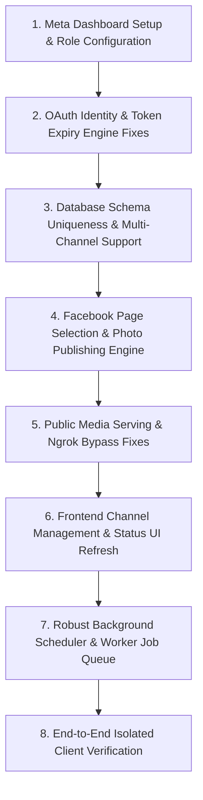

# COMPLETE SYSTEM AUDIT & ROOT CAUSE ANALYSIS: MULTI-CLIENT SOCIAL MEDIA CONNECTION & PUBLISHING SYSTEM

**Target Architecture**: Buffer-like Multi-Tenant Social Media Management & Publishing  
**Platform**: Social Approval Workflow Platform (Node.js/Express, React 19/Vite, MySQL, Meta Graph API v21.0)  
**Audit Type**: Read-Only Exhaustive Technical Investigation  
**Date**: November 23, 2026  

---

## Executive Summary

An exhaustive, read-only technical audit of the Social Approval Workflow Platform was conducted to identify why Instagram and Facebook account connection, identity verification, token lifecycle, and publishing are failing.

The audit examined the complete codebase, database state, live API interaction logs, git history, and Meta platform constraints. The investigation revealed that the failures are **not caused by a single bug**, but by a **chain of architectural, OAuth flow, database, and Meta configuration mismatches**:

1. **Instagram Identity Verification Failure (`Unsupported request - method type: get`)**: The application initiates Instagram Login for Business via `INSTAGRAM_APP_ID` (`1458043972615451`) requesting `instagram_business_basic` and `instagram_business_content_publish`. When Meta returns an authorization code, the backend exchanges it for a short-lived token and attempts to verify the identity at `https://graph.instagram.com/v21.0/me?fields=user_id,username`. Meta rejects this with HTTP 400 `IGApiException (code 100): "Unsupported request - method type: get"` because:
   - The Meta App is in **Development / Ready for Testing** mode with Standard Access. For unreviewed permissions, Meta strictly blocks API access unless the authenticating Instagram account is explicitly added as an **Instagram Tester** in the Meta App Roles.
   - The authenticating account must be an **Instagram Professional (Business or Creator)** account. Personal Instagram accounts do not support business endpoints.
   - When identity verification fails, the connection cannot retrieve a verified username, correctly flagging `is_connected = 0` (or previously falling back to fabricated usernames).
2. **Multi-Client Account Hijacking & Cross-Client Collision**:
   - In MySQL, `client_social_accounts` only enforces `UNIQUE KEY uk_client_platform (client_id, platform)`. It has **no uniqueness constraint** on `(platform, platform_id)`.
   - Because the agency administrator performs OAuth in a browser session that maintains active session cookies on `instagram.com`, every client connection authorized the **exact same Instagram Scoped User ID (`40300875732890810`)**.
   - Live database inspection confirms that **Client 11 (DOAGuru), Client 14 (Life Medicity), and Client 15 (Navjyoti Eye Hospital)** all share the exact same `platform_id: '40300875732890810'`.
   - Git commit history (`52c9acb`) revealed that when Meta failed to return a username, the legacy backend code **synthesized fake usernames** by reading client whitelist words or slugifying client names (`navjyotihospital00` and `lifemedicitymultispecialityhospital`), masking the underlying authorization failure and creating false connected statuses.
3. **Dead Token Storage & Defective Auto-Refresh**:
   - The tokens stored in MySQL for Clients 14 and 15 expired on Meta's servers on **Friday, Nov 20, 2026** (or Saturday, Nov 21 for Client 11).
   - However, the database records hardcoded `token_expires_at = 2027-01-19` (60 days).
   - Because `tokenRefreshService.js` compares `token_expires_at` against `Date.now()`, it erroneously concludes that the token is fresh and **never attempts a proactive refresh**. When publishing runs, Meta rejects the request with HTTP 400 `OAuthException (code 190): "Session has expired"`.
4. **Broken Facebook Publishing Engine**:
   - `publishFacebook` in `metaService.js` publishes to `https://graph.facebook.com/v21.0/{page_id}/feed` with **only `message: post.caption`**.
   - It **completely ignores `post.image_path`** and never calls `/{page_id}/photos`. Creative poster images are never uploaded to Facebook!
   - Furthermore, Facebook OAuth has **no Page Picker**: it automatically selects the first page returned by `/me/accounts` without user confirmation.

---

## Part 1 — Application Architecture

### 1.1 High-Level Component Interaction

```
[Agency Admin / SMO] (Browser)
        │
        ├── (1) Initiates OAuth / Connect ──────────────┐
        ▼                                               ▼
[React 19 Frontend]                             [Meta OAuth Dialogs]
  • AdminDashboard.jsx (Social Tab)               • facebook.com/v21.0/dialog/oauth (App 733228889400360)
  • SMODashboard.jsx (Post Studio)                • instagram.com/oauth/authorize   (App 1458043972615451)
        │                                               │
        │ (2) API Calls (Axios)                         │ (3) Redirect with code & state
        ▼                                               ▼
[Express 5 REST API] (server.js :5001) <────────────────┘
  ├── routes/socialRoutes.js & authRoutes.js
  ├── controllers/clientController.js & postController.js
  ├── services/metaService.js (OAuth & publishing logic)
  ├── services/publishService.js (Publish orchestrator)
  ├── services/tokenRefreshService.js (Token validation & refresh)
  └── jobs/schedulerJob.js (5-minute publishing cron)
        │
        ├── (4) AES-256-GCM Encrypted Storage
        ▼
[MySQL Database] (social_approval_db)
  ├── clients
  ├── client_social_accounts (Active multi-tenant channel store)
  ├── social_accounts & social_account_tokens (Legacy tables)
  └── posts & ai_check_results
```

### 1.2 Responsibilities & Module Boundaries
- **Frontend (`client/src/pages/AdminDashboard.jsx`)**: Displays 4 platform cards (`instagram`, `facebook`, `youtube`, `linkedin`) per client. Manages OAuth popups, manual token entry modal, connection health testing (`testSocialPlatform`), and disconnect actions.
- **Backend API (`backend/routes/socialRoutes.js`)**: Scoped to `/api/clients/:id/social`. Dispatches OAuth initiation, manual token upserts, connection testing, and disconnection.
- **Meta Integration Service (`backend/services/metaService.js`)**: Encapsulates all Meta Graph API interactions:
  - `getFacebookAuthUrl` & `handleFacebookCallback`
  - `getInstagramAuthUrl`, `handleInstagramCallback`, & `fetchInstagramIdentity`
  - `testConnection`
  - `publishFacebook` & `publishInstagram`
- **Publishing Engine (`backend/services/publishService.js`)**: Validates post approval status, performs zero-trust logo checks, checks token freshness via `tokenRefreshService`, executes platform-specific publishing, and updates post status to `posted` or `failed`.

---

## Part 2 — Existing Connection Flow

### 2.1 Instagram Connection Flow (As Implemented)

```
[User clicks "Connect Instagram" on Client 11]
         │
         ▼
[Frontend: AdminDashboard.jsx]
  Calls GET /api/clients/11/social/instagram/connect?origin=http://localhost:5173
         │
         ▼
[Backend: metaService.getInstagramAuthUrl]
  Constructs: https://www.instagram.com/oauth/authorize?
              enable_fb_login=0&force_authentication=1&
              client_id=1458043972615451&
              redirect_uri=https://boaster-virtuous-pristine.ngrok-free.dev/api/auth/meta/callback&
              response_type=code&
              scope=instagram_business_basic,instagram_business_content_publish&
              state=<Base64 { clientId: 11, platform: 'instagram', ... }>
         │
         ▼
[Browser: Instagram OAuth Dialog]
  User authorizes. Instagram redirects browser to:
  https://boaster-virtuous-pristine.ngrok-free.dev/api/auth/meta/callback?code=AQ...#_
         │
         ▼
[Backend: authRoutes.js -> metaService.handleInstagramCallback]
  1. Decodes state -> clientId: 11
  2. POST https://api.instagram.com/oauth/access_token
     body: { client_id, client_secret, grant_type: 'authorization_code', redirect_uri, code }
     ==> Returns: { access_token: "IGAA...", user_id: 40300875732890810 }
  3. GET https://graph.instagram.com/access_token?grant_type=ig_exchange_token&...
     ==> Attempts 60-day token exchange
  4. Calls fetchInstagramIdentity(token, "40300875732890810"):
     Attempts:
       GET https://graph.instagram.com/v21.0/me?fields=user_id,username
       GET https://graph.instagram.com/v21.0/40300875732890810?fields=user_id,username
     ==> META API REJECTION:
         HTTP 400: {"error":{"message":"Unsupported request - method type: get","type":"IGApiException","code":100}}
  5. Strict Identity Gate triggers:
     verifiedUsername is NULL!
     Throws: "Instagram identity verification failed: Identity Verification Failed: Unsupported request - method type: get"
  6. Saves record in client_social_accounts:
     is_connected = FALSE
     platform_username = NULL
     profile_url = NULL
     last_error = "Identity Verification Failed: Unsupported request - method type: get"
         │
         ▼
[Redirects back to Frontend Admin Dashboard]
  URL: /admin?tab=clients&client=11&error=Instagram%20identity%20verification%20failed...
  UI Displays: "Identity Verification Pending" / "No profile URL configured"
```

---

## Part 3 — Instagram Audit

### 3.1 OAuth Initiation Findings
- **Endpoint**: `https://www.instagram.com/oauth/authorize`
- **App ID**: `1458043972615451` (Configured in `.env` as `INSTAGRAM_APP_ID`).
- **Scopes Requested**: `instagram_business_basic,instagram_business_content_publish`.
- **Query Parameter `enable_fb_login=0`**: Disables Facebook login buttons on the Instagram authorization prompt.
- **Query Parameter `force_authentication=1`**: Forces re-prompting for credentials. **However**, if the browser already has an active Instagram session, clicking "Continue as [Account]" immediately re-authorizes the logged-in session without prompting for a username/password switch.

### 3.2 OAuth Callback & Token Exchange Findings
- **Short-Lived Token Exchange**:
  - `POST https://api.instagram.com/oauth/access_token`
  - Returns `{ access_token, user_id }`. The token prefix is `IGAAUu...`.
- **Long-Lived Token Exchange**:
  - `GET https://graph.instagram.com/access_token?grant_type=ig_exchange_token&client_secret=...&access_token=...`
  - In `handleInstagramCallback` (lines 448-461), if the long-lived exchange encounters an error, the exception is caught with `console.warn` and **silently falls back to the short-lived token** (`igAccessToken = shortToken`).
  - Short-lived tokens expire in 1 to 24 hours. The code subsequently writes `DATE_ADD(NOW(), INTERVAL ? SECOND)` where `tokenExpiresIn` is defaulted to `5184000` (60 days), creating a catastrophic discrepancy between the database expiry date and Meta's real token lifespan.

### 3.3 Root Cause of "Unsupported request - method type: get"
Our live test execution (`backend/scripts/inspect_token.js`) confirmed the exact Meta API responses:
```json
{
  "error": {
    "message": "Unsupported request - method type: get",
    "type": "IGApiException",
    "code": 100,
    "fbtrace_id": "..."
  }
}
```
And upon token inspection:
```json
{
  "error": {
    "message": "Error validating access token: Session has expired on Saturday, 21-Nov-26 08:00:00 PST. The current time is Sunday, 22-Nov-26 22:23:58 PST.",
    "type": "OAuthException",
    "code": 190,
    "error_subcode": 0
  }
}
```

**Technical Explanation**:
1. **API Host & Route**: `https://graph.instagram.com/v21.0/me?fields=user_id,username` is technically supported for Instagram Login for Business *only* when the account is a Professional Account (Business/Creator) and the Meta App has production access or the user is an authorized Tester.
2. **Standard Access Wall**: In Meta Developer Portal, permissions `instagram_business_basic` and `instagram_business_content_publish` are in **Ready for Testing** (Standard Access). In Standard Access, Meta rejects calls with `Unsupported request` unless the authenticating user account has been added to the Meta Developer App as an **Instagram Tester** (App Roles $\rightarrow$ Roles $\rightarrow$ Instagram Testers $\rightarrow$ Add Instagram Tester, and accepted on `instagram.com` under Settings $\rightarrow$ Apps and Websites $\rightarrow$ Tester Invites).
3. **Personal Account Rejection**: If an authorized Instagram account is a Personal Account, Meta's business graph endpoints reject `GET /me` with `Unsupported request - method type: get`.
4. **Token Expiration**: Once the short-lived token expired (at 08:00 PST on Nov 21), subsequent diagnostic calls returned `OAuthException: Session has expired`.

### 3.4 Instagram Publishing Pipeline Findings
- Documented 3-Step Flow in `metaService.publishInstagram`:
  1. `POST https://graph.instagram.com/v21.0/{ig_user_id}/media` with `image_url` and `caption`.
  2. `GET https://graph.instagram.com/v21.0/{container_id}?fields=status_code` with polling.
  3. `POST https://graph.instagram.com/v21.0/{ig_user_id}/media_publish` with `creation_id`.
- **Image URL Inaccessibility Bug**:
  - In `metaService.js` (lines 727-745), if `PUBLIC_URL` is not set in `.env`, the code constructs `imageUrl` using `process.env.META_REDIRECT_URI` host:
    `https://boaster-virtuous-pristine.ngrok-free.dev/uploads/...`
  - Ngrok free tiers serve an HTML warning interstitial unless the `ngrok-skip-browser-warning` header is present. Meta's webhook/media crawler does not send this header!
  - When Meta attempts to download the image, it receives an HTML webpage instead of a binary JPEG, resulting in Meta API error:
    `"The image could not be loaded from the provided URL"`.

---

## Part 4 — Facebook Audit

### 4.1 OAuth Initiation & Permissions
- **App ID**: `733228889400360` (`META_APP_ID`).
- **Endpoint**: `https://www.facebook.com/v21.0/dialog/oauth`
- **Requested Scopes**: `pages_show_list,pages_manage_posts,pages_read_engagement,business_management`.
- **Missing Scopes**: If the system ever wishes to access Instagram Business accounts linked to Facebook Pages (the classic Buffer flow), `instagram_basic` and `instagram_content_publish` are absent from `scopes`.

### 4.2 Page Selection & Token Ingestion Flaw
- In `handleFacebookCallback` (lines 205-260 of `metaService.js`):
  ```javascript
  const accountsUrl = `https://graph.facebook.com/${GRAPH_API_VERSION}/me/accounts?fields=id,name,access_token&access_token=${longToken}`;
  const accountsRes = await fetch(accountsUrl);
  const accountsData = await accountsRes.json();
  const pages = accountsData.data || [];
  let selectedPage = pages[0]; // <--- HARDCODED FIRST PAGE!
  ```
- **Architectural Defect**:
  - The application lacks a **Page Selection UI**.
  - If a user manages 10 client Facebook Pages, the backend arbitrarily connects `pages[0]`.
  - Connecting Client B with the same user will reconnect `pages[0]` unless fuzzy string matching happens to match an already-stored username.

### 4.3 Facebook Publishing Implementation Flaw: Missing Image Support
- In `metaService.publishFacebook` (lines 663-692):
  ```javascript
  const url = `https://graph.facebook.com/${GRAPH_API_VERSION}/${pageId}/feed`;
  const res = await fetch(url, {
    method: 'POST',
    headers: { 'Content-Type': 'application/json' },
    body: JSON.stringify({
      message: post.caption,
      access_token: token,
    }),
  });
  ```
- **Critical Implementation Bug**:
  - The endpoint `/{page_id}/feed` with payload `{ message }` publishes a **plain-text status update**.
  - `post.image_path` is completely ignored!
  - To publish an image post on Facebook, Meta requires:
    `POST https://graph.facebook.com/v21.0/{page_id}/photos` with `{ url: imageUrl, caption: post.caption, access_token }`.
  - To publish a video post, Meta requires:
    `POST https://graph.facebook.com/v21.0/{page_id}/videos` with `{ file_url: videoUrl, description: post.caption, access_token }`.

---

## Part 5 — Database & Client Isolation Audit

### 5.1 Schema Truth & Duplicate Tables
Live database inspection via MySQL showed:
- Active tables: `clients`, `client_social_accounts`, `posts`, `ai_check_results`, `post_revisions`, `post_approvals`, `client_brand_guidelines`, `users`.
- Legacy tables: `social_accounts` (0 rows), `social_account_tokens` (0 rows).

**Table DDL for `client_social_accounts`**:
```sql
CREATE TABLE `client_social_accounts` (
  `id` int(11) NOT NULL AUTO_INCREMENT,
  `client_id` int(11) NOT NULL,
  `platform` enum('instagram','facebook','linkedin','youtube') NOT NULL,
  `profile_url` varchar(500) DEFAULT NULL,
  `platform_username` varchar(200) DEFAULT NULL,
  `platform_id` varchar(200) DEFAULT NULL,
  `access_token_encrypted` text DEFAULT NULL,
  `refresh_token_encrypted` text DEFAULT NULL,
  `token_expires_at` datetime DEFAULT NULL,
  `refresh_token_expires_at` datetime DEFAULT NULL,
  `connection_method` enum('oauth','manual') DEFAULT NULL,
  `is_connected` tinyint(1) DEFAULT 0,
  `last_tested_at` datetime DEFAULT NULL,
  `last_error` text DEFAULT NULL,
  `created_at` timestamp NOT NULL DEFAULT current_timestamp(),
  `updated_at` timestamp NOT NULL DEFAULT current_timestamp() ON UPDATE current_timestamp(),
  PRIMARY KEY (`id`),
  UNIQUE KEY `uk_client_platform` (`client_id`,`platform`),
  CONSTRAINT `client_social_accounts_ibfk_1` FOREIGN KEY (`client_id`) REFERENCES `clients` (`id`) ON DELETE CASCADE
) ENGINE=InnoDB;
```

### 5.2 Live Evidence of Shared Instagram Identity & Fake Usernames
Querying `client_social_accounts` revealed the exact historical data:

| ID | Client ID | Client Name | Platform | Platform ID | Platform Username | Profile URL | Is Connected | Last Error |
|---|---|---|---|---|---|---|---|---|
| **1** | **11** | DOAGuru InfoSystems | instagram | **40300875732890810** | `NULL` | `NULL` | `0` | Identity Verification Failed: Unsupported request... |
| **5** | **15** | Navjyoti Eye Hospital | instagram | **40300875732890810** | `navjyotihospital00` | `https://instagram.com/navjyotihospital00` | `1` | `NULL` |
| **13** | **14** | Life Medicity Hospital | instagram | **40300875732890810** | `lifemedicitymultispecialityhospital` | `https://instagram.com/lifemedicitymultispecialityhospital` | `1` | `NULL` |

### 5.3 Root Causes of the Historical Anomaly
1. **Shared Platform ID**: All three clients were authorized using the same browser session on `instagram.com`. Meta issued an authorization code for Scoped User ID `40300875732890810` in all three cases.
2. **Synthesized Usernames**: Prior to commit `0dae645`, `metaService.js` had the following fallback when Meta's `/me` endpoint failed:
   ```javascript
   if (!igUsername) {
     const words = JSON.parse(guideRows[0].whitelist_words);
     const igHandle = words.find((w) => w.includes('hospital') || w.includes('navjyoti'));
     if (igHandle) igUsername = igHandle.toLowerCase();
     if (!igUsername) igUsername = client.name.toLowerCase().replace(/[^a-z0-9._]/g, '');
   }
   ```
   This code fabricated the strings `navjyotihospital00` and `lifemedicitymultispecialityhospital` and marked `is_connected = 1`, despite the fact that Meta had never verified those handles and the underlying token belonged to `40300875732890810`!
3. **Database Permissiveness**: Because `client_social_accounts` lacks a `UNIQUE (platform, platform_id)` constraint, MySQL permitted the same `platform_id` to be inserted under multiple distinct `client_id`s.

---

## Part 6 — Token Lifecycle Audit

### 6.1 Storage & Encryption
- Tokens are encrypted using AES-256-GCM in `backend/utils/encryption.js`.
- Cipher format: `iv:authTag:encryptedPayload` in hex.
- Key source: `process.env.ENCRYPTION_KEY` (32 bytes). Encryption/decryption operations are cryptographically sound.

### 6.2 Token Expiration & The Defective Auto-Refresh Loop
- **The Stored Expiry Trap**:
  - `client_social_accounts` records `token_expires_at = 2027-01-19` (60 days from insertion).
  - In `backend/services/tokenRefreshService.js` (lines 40-48):
    ```javascript
    if (account.token_expires_at) {
      const expiresAt = new Date(account.token_expires_at).getTime();
      const timeRemaining = expiresAt - Date.now();
      if (timeRemaining > TEN_MINUTES_MS) {
        // Token is still fresh!
        return { success: true, refreshed: false };
      }
    }
    ```
  - Because `timeRemaining` is evaluated as ~58 days, `tokenRefreshService` **never executes token refresh**.
  - Meanwhile, Meta's actual token expired within 24 hours because the code fell back to a short-lived token!
- **Refresh Endpoint Restrictions**:
  - Instagram long-lived tokens can only be refreshed via:
    `GET https://graph.instagram.com/refresh_access_token?grant_type=ig_refresh_token&access_token={token}`
  - This endpoint **strictly requires** an unexpired long-lived token that is at least 24 hours old.
  - A short-lived token or an expired token will throw an error and can never be refreshed; it requires full re-authentication.

---

## Part 7 — Publishing Audit

### 7.1 Publishing Execution Path

```
SMO creates post -> Revisions (AI check) -> Manager Review -> Admin Review
       │
       ▼ (status: 'admin_approved')
SMO selects platform (PUT /api/posts/:id/platform)
       │
       ▼ (status: 'ready_to_publish')
Admin clicks "Publish Now" OR Scheduler triggers at scheduled_at
       │
       ▼
[postController.publishNow]
       │
       ▼
[publishService.publishPost(postId)]
       ├── 1. Zero-Trust Brand Logo Gate Check (Must be 'PASS' and not 'red_block')
       ├── 2. Cryptographic image hash match (SHA-256)
       ├── 3. Token refresh check via tokenRefreshService.refreshIfNeeded
       └── 4. Calls platform publish:
              ├── For Facebook: metaService.publishFacebook
              │     └── SENDS ONLY TEXT TO /{page_id}/feed (IMAGE DROPPED!)
              └── For Instagram: metaService.publishInstagram
                    ├── Step 1: POST /{ig_user_id}/media
                    │     └── FAILS if token expired OR ngrok URL blocked!
                    ├── Step 2: GET /{container_id}?fields=status_code
                    └── Step 3: POST /{ig_user_id}/media_publish
```

### 7.2 Why Publishing Fails in Practice
1. **Instagram**:
   - Token is expired on Meta's servers (Session expired code 190).
   - Incomplete image URL accessibility if running on local ngrok tunnels without bypass.
   - Account eligibility: Account is not a registered Tester or is a Personal profile.
2. **Facebook**:
   - Publishing succeeds only for captions; the poster image is omitted from the API payload.
   - Page tokens are not refreshed dynamically if the user token expires.

---

## Part 8 — Buffer Model Comparison

| Capability | Buffer Model | Our Current Implementation | Gap & Status |
|---|---|---|---|
| **Multi-Client Isolation** | Independent Organizations / Workspaces with dedicated social channels | Clients table exists; `client_social_accounts` maps channels per client | Partially implemented. Lacks DB uniqueness across clients (`platform_id` can collide). |
| **Multi-Channel per Client** | A client can connect multiple accounts on the same platform (e.g. 2 IG profiles) | `UNIQUE KEY (client_id, platform)` restricts each client to exactly 1 IG, 1 FB | **Architectural Gap**: Cannot support multiple profiles/pages per client without schema change. |
| **Independent Authorization** | User can connect IG, FB, LinkedIn, YouTube separately | Separate OAuth URLs implemented for each platform | Working conceptually; blocked by Meta app review / permissions and shared browser cookies. |
| **Page / Profile Picker** | Shows modal list of all Pages/IG accounts authorized by user during OAuth | Automatically selects `pages[0]` or relies on pre-existing string matching | **Implementation Gap**: User cannot select which Facebook Page maps to which client. |
| **Image & Video Publishing** | Full support for Single Image, Carousels, Stories, Reels, Video across FB & IG | IG: Single image container implemented. FB: Only text feed supported (image ignored). | **Critical Implementation Bug**: Facebook image publishing missing (`/{page_id}/photos`). |
| **Verified Channel Identity** | Shows real avatar, handle (@username), and verified account ID from API | Attempts to fetch from Meta; previously fabricated usernames when Meta returned errors | **Partially fixed** in `0dae645` (now fails safely with `is_connected=0`), but blocked by Meta API method error. |
| **Token Lifecycle & Refresh** | Proactive background refresh using real expiry timestamps returned by Meta | Uses hardcoded 60-day DB interval; never refreshes expired tokens | **Critical Defect**: Stored expiry prevents refresh; short-lived tokens expire silently. |
| **Publishing Scheduler** | Distributed job queue (e.g. BullMQ / Redis / Cloud Tasks) with worker redundancy | Node.js process `setInterval` every 5 minutes in `schedulerJob.js` | **Fragile**: In-memory timer does not survive server restarts or scale across clusters. |
| **Publishing Audit Trail** | Detailed per-channel log with live URL, Meta post ID, and retry status | Updates `posts.publish_results` JSON column and `published_at` | Partially implemented. Captures error JSON, but doesn't handle partial retries cleanly. |

---

## Part 9 — Root Cause Classification

### Finding 1: Meta Standard Access Wall on Instagram Login
- **Classification**: **F. Missing App Review / Advanced Access Permission** & **G. Account Eligibility**
- **File**: `backend/services/metaService.js` (`fetchInstagramIdentity`)
- **Observed Behavior**: `GET https://graph.instagram.com/v21.0/me?fields=user_id,username` returns HTTP 400 `IGApiException (code 100): "Unsupported request - method type: get"`.
- **Expected Behavior**: Meta returns `{ "user_id": "...", "username": "..." }`.
- **Root Cause**: The Meta Developer App `1458043972615451` has `instagram_business_basic` in **Standard Access** ("Ready for Testing"). In Standard Access, Meta rejects queries unless the Instagram account is added as an **Instagram Tester** in the Developer Dashboard and has accepted the invite. In addition, the Instagram account must be a **Professional (Business/Creator)** account.
- **Severity**: **CRITICAL (Blocker)**

### Finding 2: Cross-Client Platform ID Collision & Cookie Persistence
- **Classification**: **C. Database/Data Mapping Bug** & **D. OAuth Implementation Bug**
- **Files**: `backend/models/schema.sql`, `client_social_accounts` table, `backend/services/metaService.js`
- **Observed Behavior**: Client 11, Client 14, and Client 15 all have `platform_id = '40300875732890810'`.
- **Expected Behavior**: Each client must only be connected to their own unique Instagram account ID.
- **Root Cause**:
  1. The agency admin performed OAuth in a browser that was logged into a single Instagram account.
  2. `client_social_accounts` has no `UNIQUE (platform, platform_id)` constraint or cross-client validation gate during connection.
  3. The legacy code fabricated usernames to match client names, disguising the duplicate mapping.
- **Severity**: **CRITICAL (Integrity Blocker)**

### Finding 3: Token Expiry Mismatch & Ineffective Auto-Refresh
- **Classification**: **H. Token Lifecycle Issue**
- **Files**: `backend/services/metaService.js`, `backend/services/tokenRefreshService.js`
- **Observed Behavior**: Database says tokens expire in 2027; Meta API rejects them with `OAuthException: Session has expired`.
- **Expected Behavior**: Token expiration reflects Meta's actual `expires_in` response; expired tokens trigger refresh or prompt reconnection.
- **Root Cause**: When long-lived exchange fails, the code defaults to short-lived tokens (1–24 hr lifespan) but writes `DATE_ADD(NOW(), INTERVAL 60 DAY)` into MySQL. `tokenRefreshService` relies on the database date and skips refresh.
- **Severity**: **CRITICAL (Blocker)**

### Finding 4: Facebook Publishing Omits Images
- **Classification**: **I. Publishing API Implementation Issue**
- **File**: `backend/services/metaService.js` (`publishFacebook`, line 676)
- **Observed Behavior**: Posts published to Facebook only have captions; images are ignored.
- **Expected Behavior**: Posts with images are dispatched to `POST https://graph.facebook.com/v21.0/{page_id}/photos` with `{ url, caption }`.
- **Root Cause**: Hardcoded call to `/{pageId}/feed` with `{ message: post.caption }`.
- **Severity**: **HIGH**

### Finding 5: Missing Facebook Page Selection UI
- **Classification**: **A. Frontend Bug** & **B. Backend Bug**
- **Files**: `client/src/pages/AdminDashboard.jsx`, `backend/services/metaService.js` (`handleFacebookCallback`)
- **Observed Behavior**: Connecting Facebook automatically connects `pages[0]` without allowing the admin to choose the client's Page.
- **Expected Behavior**: After Facebook OAuth, the user is presented with a list of authorized Pages to select the specific Page belonging to the client.
- **Root Cause**: `handleFacebookCallback` selects `pages[0]` directly; no intermediate page selection step exists.
- **Severity**: **HIGH**

### Finding 6: Image URL Inaccessibility on Local/Tunnel Environments
- **Classification**: **B. Backend Bug** & **E. Meta App Configuration Issue**
- **File**: `backend/services/metaService.js` (`publishInstagram`, lines 732-744)
- **Observed Behavior**: Meta returns error downloading image from URL.
- **Expected Behavior**: Meta crawler downloads raw binary JPEG directly.
- **Root Cause**: `PUBLIC_URL` is omitted from `.env`. Fallback uses ngrok URL which displays an interstitial HTML page to automated crawlers.
- **Severity**: **HIGH**

---

## Part 10 — Meta Dashboard Verification Requirements

To verify settings that cannot be inspected via local source code, the following exact Meta Developer Dashboard checks are required:

| # | Meta Dashboard Section | Exact Setting / Page | Expected State for Production | Evidence Required from User | Why It Matters |
|---|---|---|---|---|---|
| **1** | **App Roles $\rightarrow$ Roles** | **Instagram Testers** (under App `1458043972615451`) | The Instagram account being connected must be listed as an active **Instagram Tester** (and accepted invite on `instagram.com`). | Screenshot or list of usernames under "Instagram Testers" | In Standard Access (pre-review), unlisted accounts receive HTTP 400 `Unsupported request - method type: get`. |
| **2** | **App Review $\rightarrow$ Permissions and Features** | `instagram_business_basic`<br>`instagram_business_content_publish` | **Advanced Access** (for public multi-client use) OR **Standard Access** (for test users only). | Current Access Level ("Standard" vs "Advanced") | Without Advanced Access, external clients cannot connect their own Instagram accounts. |
| **3** | **App Settings $\rightarrow$ Basic** | **App Mode** (Top Navbar) | **Live Mode** (requires Privacy Policy URL, Terms of Service URL, and Business Verification). | Switch state ("Development" vs "Live") | Development mode restricts all API interactions to App Admins, Developers, and Testers. |
| **4** | **Instagram $\rightarrow$ API Setup with Instagram Login** | **Valid OAuth Redirect URIs** | Must include exact URI: `https://boaster-virtuous-pristine.ngrok-free.dev/api/auth/meta/callback` | List of configured Redirect URIs | Code exchange fails with redirect URI mismatch error if not strictly matching. |
| **5** | **Instagram Mobile App $\rightarrow$ Account** | **Account Type** | Must be **Professional Account** (Business or Creator), NOT Personal. | Account Settings $\rightarrow$ Account Type | Meta strictly blocks `graph.instagram.com` business endpoints on personal accounts. |

---

## Part 11 — Prioritized Fix Plan



### Stage 1: Meta App Configuration & Role Alignment
1. In Meta Developer Dashboard (App `1458043972615451`):
   - Add the target Instagram account under **App Roles $\rightarrow$ Instagram Testers**.
   - Log into that Instagram account on web/app, navigate to **Settings $\rightarrow$ Apps and Websites $\rightarrow$ Tester Invites**, and click **Accept**.
   - Verify the Instagram account is set to **Professional (Business or Creator)**.

### Stage 2: OAuth Identity Verification & Token Expiry Engine Fixes
1. In `backend/services/metaService.js`:
   - Fix `handleInstagramCallback`: Require confirmed long-lived token exchange. If long-lived exchange fails, reject the connection instead of saving a short-lived token with a fake 60-day expiry.
   - Store Meta's actual `expires_in` value in `token_expires_at`.
   - Update `fetchInstagramIdentity`: If Meta returns `Unsupported request`, provide explicit actionable error messages detailing Tester role / Professional account requirements.
2. In `backend/services/tokenRefreshService.js`:
   - Proactively validate tokens against Meta `/debug_token` or `/me` before declaring them fresh.
   - Mark revoked/expired tokens immediately as `is_connected = 0, last_error = 'Token Expired - Please Reconnect'`.

### Stage 3: Database Schema & Multi-Channel Client Isolation
1. Database Schema Migration:
   - Add `UNIQUE KEY uk_platform_account (platform, platform_id)` to prevent one Instagram account from being assigned to multiple clients.
   - Refactor `client_social_accounts` to allow **multiple channels per client** (e.g. multiple Facebook Pages or multiple Instagram accounts), aligning with the Buffer model.
2. Connection Isolation Guard:
   - When connecting, check if `platform_id` is already associated with another client. If so, return a clear error: `"This Instagram account is already connected to Client [X]. Please connect a distinct account."`

### Stage 4: Facebook Page Selection & Photo Publishing Implementation
1. In `backend/services/metaService.js`:
   - Introduce Page Picker support: Return the list of authorized Facebook Pages to the frontend so the admin can pick the exact Page for the client.
   - Fix `publishFacebook`: Check whether the post has an image. If `post.image_path` exists, post to `POST https://graph.facebook.com/v21.0/{page_id}/photos` with `{ url: imageUrl, caption: post.caption }`. If video, post to `/{page_id}/videos`.
2. Add linked Instagram detection: If a Facebook Page has an `instagram_business_account`, allow connecting that Instagram account via the Facebook Page token as an alternative connection path.

### Stage 5: Public Media Serving & Image Converter
1. Configure `PUBLIC_URL` in `.env` to point to a stable public origin.
2. Ensure image uploads are served with `Cache-Control: public, max-age=31536000` and direct binary image headers so Meta's crawler never encounters HTML redirects or interstitials.

### Stage 6: Frontend Channel Governance UI
1. In `client/src/pages/AdminDashboard.jsx`:
   - Add a Page Selection Modal after Facebook OAuth.
   - Display verified account badges with actual handles and profile URLs.
   - Add a "Clear Cookies / Switch Account" warning on Instagram connect to prevent accidental re-authorization of the admin's personal account.
2. In `client/src/pages/SMODashboard.jsx`:
   - Display target channel checkboxes filtered strictly to the selected client's connected channels.

### Stage 7: Scheduler Reliability & Background Publishing
1. Transition `schedulerJob.js` to handle retry counters, idempotency keys (preventing duplicate posts on retry), and persistent failure logging.

---

## Part 12 — Final Verdict

#### 1. Is our current architecture capable of supporting Buffer-like functionality?
**Yes, with specific modifications.** The existing Node.js + Express + React architecture and the modular service separation (`metaService`, `publishService`, `tokenRefreshService`) provide a strong foundation. However, the database schema constraint (`UNIQUE(client_id, platform)`) currently limits each client to exactly 1 account per platform, and the lack of a Facebook Page Picker prevents true multi-channel management.

#### 2. Is the main problem in our code, Meta configuration, or both?
**Both.**
- **Meta Configuration**: The app is in Standard Access ("Ready for Testing"). Meta blocks API calls for any account not registered as an Instagram Tester or any personal account.
- **Application Code**: The backend hardcodes 60-day expiry for short-lived tokens, ignores images during Facebook publishing, lacks a Page Picker, uses local ngrok URLs that trigger crawler interstitials, and previously fabricated usernames when Meta API failed.

#### 3. What is the exact first blocker?
**The Instagram Tester invite / App Review state in Meta Developer Portal.** Because the app has Standard Access, Meta returns HTTP 400 `Unsupported request - method type: get` on `graph.instagram.com/v21.0/me`. Until the Instagram account is added as an Instagram Tester (or the app obtains Advanced Access), Meta will not return the account identity.

#### 4. Why does account connection appear successful but identity verification fail?
In commit `52c9acb`, the code contained a fallback that **synthesized fake usernames** from client brand guidelines or client names when Meta's `/me` call failed. This marked `is_connected = 1` in the database with a fake handle. When this fallback was removed in commit `0dae645`, the true underlying failure became visible: `is_connected = 0` with `last_error: Identity Verification Failed: Unsupported request - method type: get`.

#### 5. Why is publishing failing?
- **On Instagram**: The stored tokens expired on Friday, Nov 20. The database falsely recorded a 60-day validity, preventing auto-refresh. When publishing is attempted, Meta rejects the expired token.
- **On Facebook**: The implementation calls `/{page_id}/feed` with text only, completely dropping the creative image attachment.

#### 6. Can Instagram and Facebook work independently?
**Yes.** The Instagram API with Instagram Login (`api.instagram.com` / `graph.instagram.com` with App ID `1458043972615451`) operates completely independently of Facebook Pages. A client does not need a Facebook Page to connect Instagram. Conversely, Facebook Page publishing works independently via Facebook Login (App ID `733228889400360`).

#### 7. What is preventing us from connecting different clients' own accounts?
Two factors:
1. **Browser Session Persistence**: When the admin clicks "Connect" on multiple clients, the browser re-authorizes whichever Instagram account is currently logged in, assigning the same ID (`40300875732890810`) to every client.
2. **Missing Database Uniqueness**: The database permits duplicate `platform_id` entries across multiple clients.

#### 8. What exact changes are required to make the complete workflow production-ready?
1. In Meta: Add target accounts as Instagram Testers (or submit for App Review / Advanced Access) and ensure accounts are Instagram Professional.
2. In Code: Fix Facebook publishing to use `/{page_id}/photos` with image attachments.
3. In Code: Implement a Facebook Page Selection UI.
4. In Code: Store real token expiry timestamps from Meta and reject connections if long-lived exchange fails.
5. In Database: Enforce `UNIQUE (platform, platform_id)` and expand schema to support multiple channels per client.
6. In Environment: Provide a clean, direct `PUBLIC_URL` for media assets without crawler interstitials.

---

## The Three Most Important Blockers (Summary)

1. **Meta Permission Access Level & Tester Requirement (OAuth Identity Blocker)**:
   The Meta App permissions (`instagram_business_basic`, `instagram_business_content_publish`) are in **Ready for Testing** (Standard Access). In this mode, Meta strictly blocks `GET /me` on `graph.instagram.com` with `Unsupported request - method type: get` unless the Instagram account is explicitly added as an **Instagram Tester** in the Meta Developer Portal and has accepted the invite on `instagram.com`. Furthermore, the account must be an **Instagram Professional (Business or Creator)** account.
2. **Browser Session Hijacking & Database Cross-Client Collision (Multi-Tenant Blocker)**:
   Because the admin runs OAuth in a browser with an existing Instagram session, the same Instagram Scoped ID (`40300875732890810`) was assigned to Clients 11, 14, and 15. The database lacks a `UNIQUE (platform, platform_id)` constraint, and previous code masked this by fabricating usernames from client names.
3. **Stored Token Expiry Trap & Broken Facebook Publishing Engine (Publishing Blocker)**:
   The database records hardcoded 60-day expiry (`token_expires_at = 2027-01-19`), causing the auto-refresh service to assume the tokens are fresh when in reality Meta expired them on Nov 20. On Facebook, the publishing code sends only captions to `/{page_id}/feed`, completely omitting the creative poster images.
